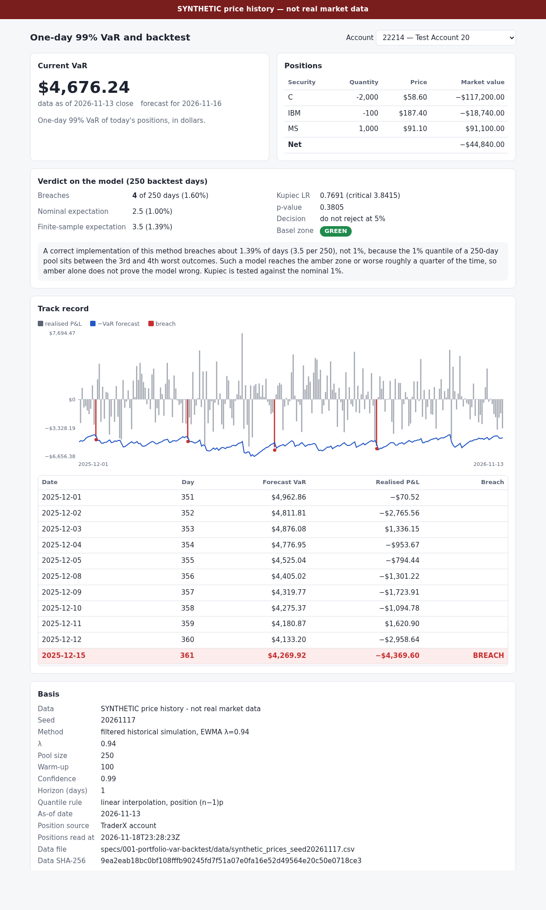

# Pre-registered VaR for TraderX

**Hackathon Track:** Track 1 — TraderX

A risk service for TraderX that shows each account's one-day 99% VaR (filtered historical
simulation), a 250-day backtest, and a Kupiec / Basel traffic-light verdict. It is built with a
pre-registered spec-driven workflow: the expected numbers were written into the spec before any
code, one AI model implements, and a different AI model writes the tests and an independent
second implementation from the spec alone. Every disagreement is recorded, not hidden.
Prices are synthetic and labelled as such.

**Presentation:** [slides (PDF)](Presentations/slides.pdf) for the Nov 20 judging.

## Quick start

Requirements: Docker with Compose v2.24+ and, for the tests, Python 3.9+ with pytest. Clone outside
`/tmp` if your Docker is the snap package (its `/tmp` is private, so bind mounts fail).

```sh
docker compose -f traderx/pricing-awareness-market-data/docker-compose.yml \
               -f deploy/tau.override.yml --project-name traderx-tau up -d --build
curl -s http://127.0.0.1:18110/health
```

Open <http://127.0.0.1:18110/> and pick **Test Account 20 (22214)**. Every port is published on
127.0.0.1 only. Stop with the same command and `down`.



For account 22214 (C −2,000, IBM −100, MS +1,000) the page shows a one-day 99% VaR of $4,676.24
"forecast for 2026-11-16", 4 breaches in 250 backtest days against 2.5 nominal and 3.5
finite-sample expected, Kupiec LR 0.7691 (p = 0.3805, do not reject), Basel zone green, and the
full basis of every number. The same results are available as JSON:

```sh
curl -s http://127.0.0.1:18110/api/v1/risk/accounts/22214
curl -s -X POST http://127.0.0.1:18110/api/v1/risk/positions \
     -H 'Content-Type: application/json' -d '{"positions":[{"security":"BAC","quantity":-2400}]}'
```

The service, its modules and the API are described in [risk-service/README.md](risk-service/README.md)
and [contracts/http-api.md](specs/001-portfolio-var-backtest/contracts/http-api.md).

## How it was built: pre-registered spec-driven development

The point of this project is less the VaR number than how you can trust it. The workflow
([constitution](.specify/memory/constitution.md)) is:

1. **Pre-register.** Before any code, [spec.md](specs/001-portfolio-var-backtest/spec.md) fixes the
   method (M1–M7) and the expected results (V1–V6): a hand-checkable example to $0.0001, a
   known-answer coverage band of [1.24%, 1.54%] (not 1%, because of the quantile rule), a
   no-look-ahead test, and a Kupiec/Basel reference table. The synthetic price file is generated
   and checksummed first.
2. **A different model writes the tests.** The tests in [tests/](tests/) and an independent second
   implementation of the method were written by a different AI model (gpt-5.6-terra via codex-cli)
   from the spec and contracts alone, run in an empty folder with a read-only sandbox and its event
   log checked. Every prompt, input checksum and raw answer is kept in
   [validation/validator/](specs/001-portfolio-var-backtest/validation/validator/).
3. **Tests first, and red.** The tests were committed before any implementation and shown to fail
   for the right reason ([red-run.txt](specs/001-portfolio-var-backtest/validation/validator/red-run.txt)).
   The implementing model (Claude) is blocked from editing `tests/`
   ([settings-probe.md](specs/001-portfolio-var-backtest/validation/validator/settings-probe.md)).
4. **Implement, then prove.** The calculation core passed all 20 offline tests on its first run;
   the service passes the 6 HTTP tests, and its results agree with the independent implementation
   within $0.01 on all 500 seeded account-days.
5. **Record every disagreement.** [disputes.md](specs/001-portfolio-var-backtest/disputes.md) keeps
   what went wrong, including a first validator model (qwen3-coder:30b) whose tests and oracle could
   not be used after two retries, the switch to a different model, and two gaps in our own spec
   and contracts that the validator exposed.

## Evidence

| What | Where |
|---|---|
| Requirement → code → test → evidence, row by row | [traceability.md](specs/001-portfolio-var-backtest/traceability.md) |
| Submission gate, including a start from a fresh clone | [gate.txt](specs/001-portfolio-var-backtest/validation/runs/gate.txt) |
| Offline and HTTP test runs | [validation/runs/](specs/001-portfolio-var-backtest/validation/runs/) |
| Response time (about 0.02 s per account) | [latency.txt](specs/001-portfolio-var-backtest/validation/runs/latency.txt) |
| Byte-identical results across a restart | [sc008-restart.txt](specs/001-portfolio-var-backtest/validation/runs/sc008-restart.txt) |

TraderX itself is unchanged: the only additions are `risk-service/`, `deploy/tau.override.yml` and
the feature folder, and `git diff fbdfb38 -- traderx/` is empty.

## Development setup

```sh
PYTHONPATH=risk-service python3 -m pytest tests/unit tests/oracle -q      # tier 1, offline
RISK_BASE_URL=http://127.0.0.1:18110 TRADERX_BASE_URL=http://127.0.0.1:8080 \
  PYTHONPATH=risk-service python3 -m pytest tests/integration -q         # tier 2, stack running
```

The service uses the Python standard library only. To run it without Docker against a TraderX whose
account and position services are on 18088 and 18090: `PYTHONPATH=risk-service python3 -m risk_service.server`.

## Roadmap

1. Real market data behind the same contracts, with the synthetic file kept as the regression fixture.
2. Expected Shortfall and conditional-coverage (Christoffersen) tests, pre-registered the same way.
3. A fault-injection hook so the TraderX-unavailable outcome is covered by an automated test.

## Contributing

Coding agents should follow [AGENTS.md](./AGENTS.md), which requires a Developer Certificate of Origin sign-off on every commit.

**All commits** must be signed with a DCO signature to avoid being flagged by the DCO Bot. This means that your commit log message must contain a line that looks like the following one, with your actual name and email address:

```
Signed-off-by: John Doe <john.doe@example.com>
```

See [CONTRIBUTING.md](./CONTRIBUTING.md) for more information.

## License

Copyright 2026 FINOS

Distributed under the [Apache License, Version 2.0](http://www.apache.org/licenses/LICENSE-2.0).

SPDX-License-Identifier: [Apache-2.0](https://spdx.org/licenses/Apache-2.0)
